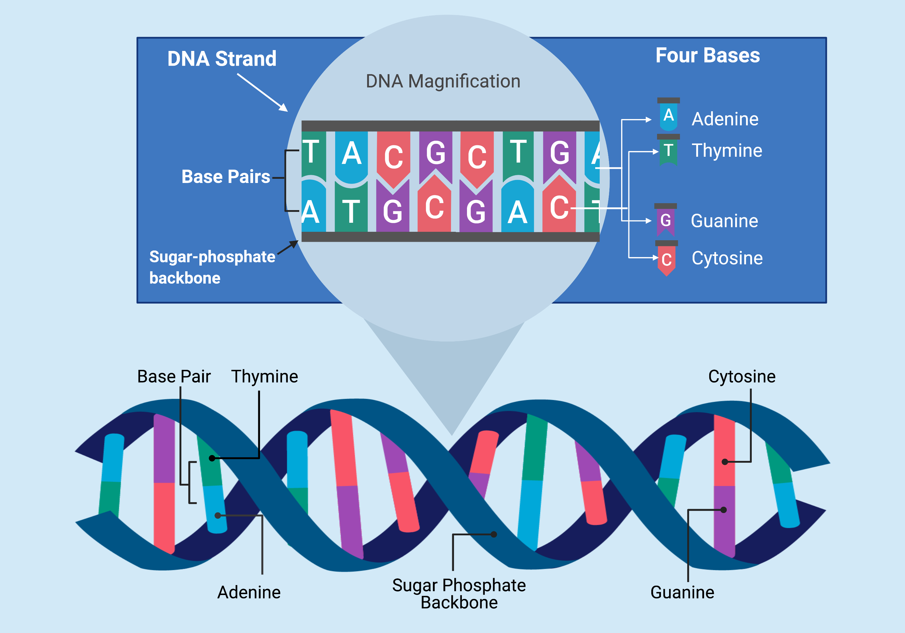
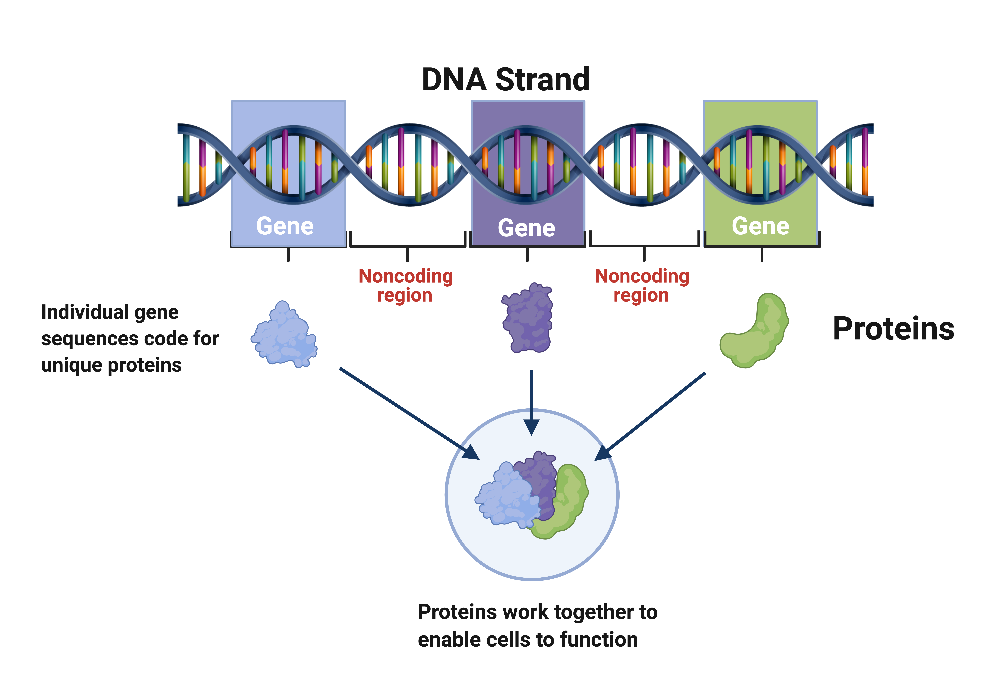
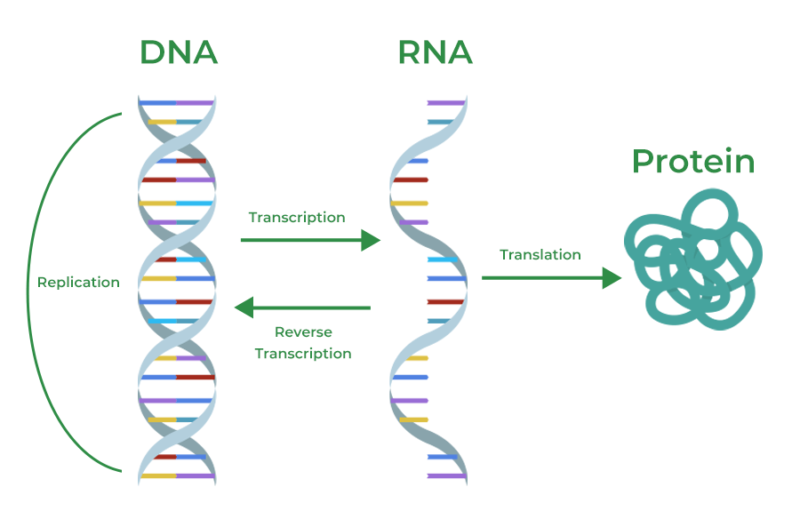
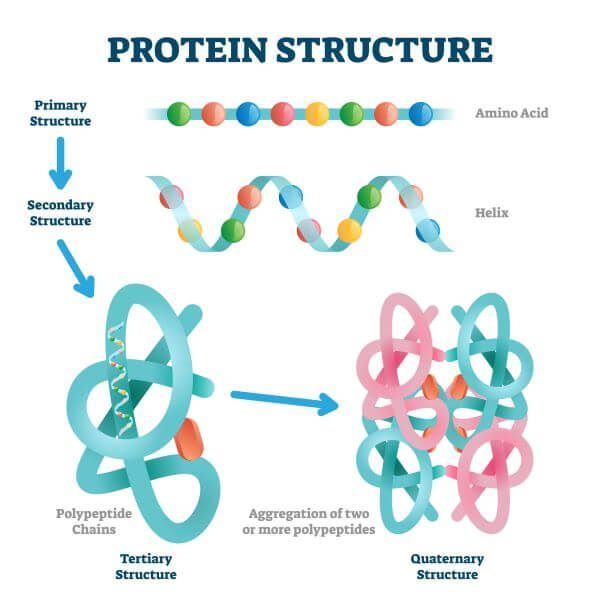
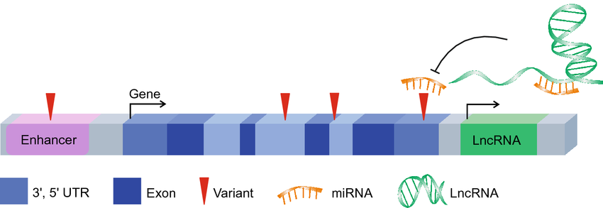

* TOC
{:toc}

If you come from an AI/ML background and want to work on biomedical problems, the sheer volume of biology jargon can feel overwhelming. This post is a concise reference — it won't make you a biologist, but it will give you enough vocabulary and intuition to read papers, understand datasets, and have productive conversations with domain experts.

We'll cover the major areas where AI is making an impact in biomedical research: **molecular biology**, **genomics**, **proteins**, and **drug discovery**. For the clinical practice side — medical imaging and electronic health records — see the companion post [Clinical AI Basics for ML People](/2026/02/13/clinical-ai-basics/).

Biology (what exists)
   ↓
Measurement & lab experiments (how biology becomes data)
   ↓
Bioinformatics (How measurements become datasets)
   ↓
Statistical genetics & AI (How models learn from those datasets)
   ↓
Applications (how predictions are used)
   ↓
Agents (how systems coordinate the whole loop)

# 🌱 Biological Foundations

## The Central Dogma: DNA → RNA → Protein

| Term | What It Is |
|------|-----------|
| **DNA** | A double-stranded molecule made of 4 nucleotide bases: A, T, C, G. Organized into genes. |
| **Gene** | A segment of DNA that encodes a specific protein (or functional RNA). Humans have ~20,000 protein-coding genes. |
| **RNA** | Single-stranded copy of a gene. **mRNA** (messenger RNA) carries the protein recipe. Other types (tRNA, rRNA, miRNA) have regulatory roles. |
| **Protein** | A molecule made of amino acids, built from instructions in a gene. Proteins do most of the work in cells — catalyzing reactions, signaling, providing structure, and more. |

<figure style="text-align: center;">
  
  <figcaption>
    The DNA double helix is formed by two complementary strands of nucleotide bases (A, T, C, G) connected by base pairs along a sugar-phosphate backbone. (Source: <a href="https://www.fjc.gov/content/361230/DNA-basics-nucleotides-genes-genome">Federal Judicial Center</a>)
  </figcaption>
</figure>

<figure style="text-align: center;">
  
  <figcaption>
    DNA is organized into genes, which code for proteins that work together to enable cells to function. Noncoding regions separate the genes. (Source: <a href="https://www.fjc.gov/content/361230/DNA-basics-nucleotides-genes-genome">Federal Judicial Center</a>)
  </figcaption>
</figure>

The Central Dogma of molecular biology is a concept that outlines the flow of genetic information within a biological system. The key steps in the Central Dogma are shown below:

<figure style="text-align: center;">
  
  <figcaption>
    Figure 1: The Central Dogma — DNA replicates itself, is transcribed into RNA, and RNA is translated into Protein. Reverse transcription (RNA → DNA) occurs in retroviruses. (Source: <a href="https://www.geeksforgeeks.org/biology/central-dogma-steps-guide/">GeeksforGeeks</a>)
  </figcaption>
</figure>

### Step 1: Replication (DNA → DNA)

Before a cell divides, it must copy its entire genome so each daughter cell gets a complete set of instructions. **DNA replication** is this copying process.

### Step 2: Transcription (DNA → RNA)

**Transcription** is the process of copying a gene from DNA into a messenger RNA (mRNA) molecule. This happens inside the **cell nucleus**.

After transcription, the mRNA undergoes processing (capping, splicing out introns, adding a poly-A tail) before leaving the nucleus.

### Step 3: Translation (RNA → Protein)

**Translation** is the process of reading the mRNA sequence to assemble a chain of amino acids (a protein). This happens at **ribosomes** in the **cytoplasm**. The polypeptide chain then folds into its functional 3D structure — **the protein**.

### Notable Exception: Reverse Transcription

In retroviruses (e.g., HIV), the enzyme **reverse transcriptase** copies RNA back into DNA — reversing the usual flow. This was a major discovery that showed the central dogma is a general principle, not an absolute rule.

The next two sections cover proteins from two complementary angles: **Proteins & Structural Biology** covers sequence → shape → dynamics (*the what*), while **From Genes to Biological Function** covers genotype/phenotype → gene regulation → protein function → molecular interactions (*the so what*).

## Proteins & Structural Biology (The "Building" Phase)

| Term | What It Is |
|------|-----------|
| **Amino acid** | The building block of proteins. There are 20 standard amino acids, each with a 1-letter code (e.g., A = Alanine, G = Glycine). |
| **Protein sequence** | A chain of amino acids, also called a polypeptide. Typical length: 100–1,000+ residues. |
| **Primary structure** | The linear amino acid sequence. |
| **Secondary structure** | Local folding patterns: **alpha helices** (spirals) and **beta sheets** (flat, pleated). |
| **Tertiary structure** | The full 3D fold of a single protein chain. |
| **Quaternary structure** | Multiple protein chains assembled together into a complex. |

<figure style="text-align: center;">
  
  <figcaption>
    The four levels of protein structure — from the linear amino acid sequence (primary) through local folding patterns (secondary), the full 3D fold (tertiary), to multi-chain complexes (quaternary). (Source: <a href="https://biologydictionary.net/protein-structure/">Biology Dictionary</a>)
  </figcaption>
</figure>

### Protein Folding (sequence → shape)

The sequence of amino acids determines how a protein folds into its 3D structure — but predicting that structure from sequence alone was one of biology's grand challenges for over 50 years. In 2020, DeepMind's [AlphaFold2](https://www.nature.com/articles/s41586-021-03819-2) achieved near-experimental accuracy in the CASP14 competition, effectively solving the problem for single-chain proteins. The follow-up [AlphaFold3](https://www.nature.com/articles/s41586-024-07487-w) (2024) extended predictions to protein complexes, nucleic acids, and small molecules. The folding process is driven by physical forces: hydrophobic residues pack into the interior, hydrogen bonds stabilize helices and sheets, and disulfide bonds lock parts of the structure in place.

Misfolded proteins are implicated in diseases like Alzheimer's (amyloid-beta plaques), Parkinson's (alpha-synuclein aggregates), and prion diseases. **Structure determines function** — a protein's 3D shape dictates what it can bind to and what reactions it can catalyze.

### Conformation & Dynamics (shape moves)

Proteins are not rigid — they flex, breathe, and shift between **conformational states**. A protein may have an "open" and "closed" conformation, and ligand binding can induce conformational changes (**induced fit**). Some proteins function as molecular switches, toggling between active and inactive conformations (e.g., GTPases like RAS).

<figure style="text-align: center;">
  
  <figcaption>
    Molecular dynamics simulations capture how proteins flex and shift between conformational states over time. (Source: <a href="https://www.creative-biostructure.com/">Creative Biostructure</a>)
  </figcaption>
</figure>

Understanding dynamics matters for drug design: a drug must fit the protein in its relevant conformation, and some drugs work by trapping the protein in a specific state. Techniques like **molecular dynamics (MD) simulation** model protein motion by computing the physical forces on every atom at femtosecond (10⁻¹⁵ s) time steps, producing trajectories of how the protein moves over time. Classical MD tools like [GROMACS](https://www.gromacs.org/) and [OpenMM](https://openmm.org/) can simulate microsecond-scale dynamics, while specialized hardware like [Anton](https://www.science.org/doi/10.1126/science.1187409) has reached millisecond timescales. More recently, ML-based approaches are learning to predict conformational ensembles directly — bypassing expensive simulation altogether.

## From Genes to Biological Function (The "Action" Phase)

| Level | Key Player | Analogy |
|-------|-----------|---------|
| **Genotype** | DNA Variants (SNPs, Indels) | The Blueprint |
| **Regulation** | Transcription Factors, Epigenetics, Splicing | The Project Manager |
| **Function** | Proteins, Active Sites | The Physical Infrastructure |
| **Phenotype** | Traits, Disease, Drug Response | The Building’s Performance |

The central dogma tells you how a gene becomes a protein. Protein structure tells you what shape it takes. But how do genes actually relate to what an organism *does*, its traits, its diseases?

### Genotype vs. Phenotype

At the most basic level, individuals differ in their DNA sequence (**genotype**) — genetic variation at the gene level. But genetic variation alone does not determine outcomes - what you observe (traits, disease risk, drug response) (**phenotype**).

The same genome can produce very different phenotypes depending on which genes are expressed, how they are regulated, and what environment the organism is in.Understanding this gap and the many layers between code and consequence is the central challenge of **modern genetics**.

**Genetic variation:**

Let's start by separating what is encoded in DNA from what is ultimately expressed and observed. Not everyone's DNA is the same. Genetic variation is what makes individuals different and what underlies susceptibility to disease. Most genetic variation is **germline**—inherited from our parents and present in every cell from birth—forming the blueprint of our unique biology. However, variation can also be **somatic**, occurring in specific cells throughout our lives due to environmental factors or aging. These changes, whether inherited or acquired, fall into several structural categories:

- **SNPs** (single nucleotide polymorphisms): Single base changes (e.g., A → G). The most common type of variation — millions per genome. While most are "neutral," their impact on phenotype depends on their locations as described below.

- **Indels**: Insertions or deletions of short sequences (1–50 base pairs). These can be particularly disruptive if they shift the "reading frame" of a gene.

- **Structural variants**: Larger rearrangements — deletions, duplications, inversions, translocations (>50 bp). Less common but can have large effects.

- **Copy number variants (CNVs)**: Regions where the number of copies differs between individuals.

**Molecular consequences of variants:**

The impact of a genetic variant is determined by its "context" -- whether it lands in the instructions for building a protein or the instructions for regulating it. A single mutation can be as harmless as a silent typo or as catastrophic as a missing engine part.

<figure style="text-align: center;">
  
  <figcaption>
    The Anatomy of a Gene: This diagram illustrates the flow of genetic information from DNA to Protein. The Promoter and UTRs (orange) are non-coding regions that regulate when and how much protein is made. The Protein-coding regions (grey) are the "Exons," where coding variants like missense or nonsense mutations directly alter the final protein product. Think of this as a factory assembly line. The Promoter is the "On" switch, the UTRs are the speed controllers, and the Exons (grey) are the actual raw materials. Coding variants change the materials themselves, while non-coding variants change how the machinery operates.
  </figcaption>
</figure>

**Coding variants** occur within the "exons" of a gene and directly alter the protein product:

- **Missense**: A single base change results in a different amino acid. This can subtly change protein stability or completely "break" an active site.
- **Nonsense**: A change creates a premature "stop" signal, resulting in a truncated, usually non-functional protein.
- **Frameshift**: Usually caused by Indels, these shift the entire "reading frame" of the DNA, garbling every amino acid that follows.

<figure style="text-align: center;">
  
  <figcaption>
    The Regulatory Landscape: A detailed look at the "98%" of the genome that does not code for proteins. Red triangles indicate Variants occurring in regulatory elements like Enhancers and LncRNAs. Because these regions act as "volume knobs" for gene expression, they are the primary sites where variations linked to complex diseases (like diabetes or depression) are found in GWAS. This represents the "Software" of the genome. While the Exons (dark blue) provide the code for the hardware, elements like Enhancers and miRNAs act as the operating system. Variants here don't break the machine, but they "reprogram" it, leading to the subtle changes in expression levels often seen in complex psychiatric and metabolic conditions. (Source: <a href="https://louis.pressbooks.pub/generalbiology1leclab/chapter/regulation-of-gene-expression/">Regulation of Gene Expression — General Biology</a>)
  </figcaption>
</figure>

**Non-coding variants** occur in the 98% of the genome that does not code for proteins. Rather than changing the "hardware," they alter the "software" (gene regulation):
- They can change expression levels (how much protein is made) or splicing patterns (how the protein is assembled).
- Because they act as "volume knobs," most variations identified in GWAS (Genome-Wide Association Studies) for complex diseases like diabetes or depression are non-coding.

**Variant Interpretation**: Most variants are benign (harmless) or "variants of uncertain significance" (VUS). Distinguishing these from pathogenic (disease-causing) mutations is the primary challenge of clinical genomics and a major focus for AI models.

### Gene Regulation: The Cellular Control System

Having a genetic variant is only the first layer—whether it actually affects an organism depends on which genes are expressed, when, and where. While every cell in your body shares the same genome, a neuron looks and behaves nothing like a liver cell because of **gene regulation**: the process of turning specific genes on (expressed) or off (silenced).

<figure style="text-align: center;">
  
  <figcaption>
    Overview of gene regulation. (Source: <a href="https://louis.pressbooks.pub/generalbiology1leclab/chapter/regulation-of-gene-expression/">Regulation of Gene Expression — General Biology</a>)
  </figcaption>
</figure>

####**Structural Access: Epigenetics & Chromatin**

<figure style="text-align: center;">
  
  <figcaption>
    Epigenetic mechanisms regulating gene expression. (Source: <a href="https://doi.org/10.1038/s41392-024-02030-9">Signal Transduction and Targeted Therapy, Springer Nature</a>)
  </figcaption>
</figure>

Epigenetics studies how cells control gene activity without changing the DNA sequence."Epi-"means on or above in Greek,and "epigenetic" describes factors beyond the genetic code. Epigenetic changes are modifications to DNA that regulate whether genes are turned on or off. These modifications are attached to DNA and do not change the sequence of DNA building blocks. 

Before a gene can be read, the DNA must be physically accessible.

**Epigenetics** — Chemical modifications that change gene activity without altering the DNA sequence:

- **DNA methylation**: Adding methyl groups to cytosine bases. Generally silences gene expression. Patterns differ across cell types and change with age and disease.

- **Histone modification**: DNA wraps around histone proteins like thread on spools. Chemical modifications (acetylation, methylation, phosphorylation) to histones control how tightly DNA is packed:

    - loosely packed (**euchromatin**) = accessible for transcription;

    - tightly packed (**heterochromatin**) = silenced.

**Chromatin accessibility** — Physical accessibility of DNA regions matters. Tightly packed chromatin is inaccessible to transcription machinery.

####**The Decision Makers: Transcription Factors (TFs)**

<figure style="text-align: center;">
  
  <figcaption>
    Transcription factors binding to DNA regulatory elements to activate or repress gene transcription. (Source: <a href="https://commons.wikimedia.org/wiki/File:Transcription_Factors.svg">Wikimedia Commons</a>)
  </figcaption>
</figure>

Once the DNA is open, specialized proteins called Transcription Factors bind to specific DNA sequences to activate or repress transcription:

- **Promoters**: DNA regions just upstream of a gene where transcription machinery assembles.

- **Enhancers**: Regulatory sequences that can be far from the gene they control, boosting transcription when bound by the right transcription factors.

- **Combinatorial Control**: Transcription factors work combinatorially — genes aren't controlled by one TF, but by different TF combinations in different cell types (like a "barcode" of several). **Cell-type specificity** means different cell types express different subsets of genes, achieved through cell-type-specific combinations of transcription factors, epigenetic marks, and chromatin states. This is why single-cell technologies (scRNA-seq, scATAC-seq) are so important — they reveal gene regulation at cellular resolution.

####**Post-Transcriptional Tuning:**
Even after a gene is transcribed into RNA, the cell can still change the final outcome:

- **Alternative splicing**: A single gene can produce multiple different mRNA variants (and thus different proteins) by including or skipping certain exons. ~95% of human genes undergo alternative splicing.

- **Non-coding RNA**: miRNA, lncRNA, and other RNA molecules that regulate gene expression post-transcriptionally, often by degrading mRNA or blocking translation.

### Proteins as Functional Units

After translation, proteins fold into complex 3D shapes to become the "nanomachines" of the cell. A protein's function is a direct result of its topography—the specific valleys, ridges, and chemical charges on its surface.

#### **Mechanism of Action: The Active Site**

The "business end" of a protein is usually the active site. This is a specific pocket or cleft designed to interact with other molecules.

- **Precision**: Active sites have a precise 3D geometry. Even a single amino acid mutation can "clog" or "warp" this pocket, rendering the protein useless.

- **Induced Fit**: Proteins are not rigid; they are dynamic. When a target molecule approaches, the active site undergoes a conformational shift—essentially "hugging" the target to create a tighter bond. This is known as Induced Fit.

#### **From Structure to Role: Categories of Function**

How a protein uses its active site determines its "job description" in the body. Most therapeutic drugs are designed to target one of these specific categories:

| Category | Primary Function | Pharmaceutical Context |
|----------|-----------------|----------------------|
| **Enzymes** | Catalysts: They speed up chemical reactions (e.g., Kinases, Proteases). | Many drugs are inhibitors that sit in the active site to stop the enzyme from working. |
| **Receptors** | Sensors: They sit on cell membranes and detect external signals (e.g., GPCRs). | ~34% of FDA-approved drugs target GPCRs to turn cellular signals "on" or "off." |
| **Transporters** | Gates: They move ions or nutrients across the cell membrane. | Drugs can block these "gates" to change cell chemistry (e.g., SSRIs for serotonin). |
| **Structural** | Scaffolding: Provide mechanical support (e.g., Collagen, Actin). | Critical for tissue integrity; often targets for regenerative medicine. |
| **Antibodies** | Defense: Recognize and neutralize "non-self" molecules. | Monoclonal antibodies are engineered proteins used to "tag" cancer cells for destruction. |

#### **Modulating Function: Ligands & Binding**

To understand how we use drugs to treat disease, we must understand the **Ligand**. A ligand is any molecule (a drug, a hormone, or a nutrient) that binds to a protein to influence its behavior.

**Where do Ligands bind?**

A drug's effectiveness depends on where it attaches to the protein:

- **Orthosteric (Active) Site**: The drug competes directly with the natural substrate for the "front door."

- **Allosteric Pocket**: The drug binds to a side "remote control" site. This changes the protein's shape from a distance, either boosting or muffling its activity.

#### **Measuring Success: Binding Metrics**

In drug discovery, we use specific metrics to determine how "sticky" or effective a ligand is. If a protein is the "lock," these metrics tell us how well the "key" fits and turns.

**Affinity: How "sticky" is the bond?**

Binding Affinity measures the strength of the attraction between a ligand and the protein.

- $K_d$ (Dissociation Constant): This measures the concentration of a drug needed to occupy 50% of the protein targets.

- Rule of Thumb: Lower $K_d$ = Tighter Binding. A drug with a nanomolar ($nM$) $K_d$ is much more potent than one with a micromolar ($\mu M$) $K_d$.

**Efficacy: How well does it stop the process?**

While $K_d$ measures "stickiness," these metrics measure the actual biological impact:

- $IC_{50}$: The concentration of a drug required to inhibit a biological process by 50%. This is highly useful for screening, but can change depending on the lab conditions (assay-dependent).

- $K_i$ (Inhibition Constant): Unlike $IC_{50}$, $K_i$ is an intrinsic property. It reflects the true "power" of an inhibitor regardless of how much enzyme is used in the experiment.

## Systems Biology

Biological systems are more than the sum of their parts. **Systems biology** studies how molecular components interact to produce emergent behaviors — cell signaling, homeostasis, disease.

### Biological Pathways & Networks

Genes and their protein products don't work in isolation. They interact in **pathways** and **networks** — coordinated molecular events that carry out biological functions.

- **Signaling pathways (The Communication)**: Relay information from outside the cell to the nucleus, triggering changes in gene expression or cell behavior. Examples: the **MAPK/RAS pathway** (frequently mutated in cancer), **Wnt pathway** (cell growth and differentiation), **Notch pathway** (cell fate decisions). Identifying "driver mutations" in pathways like MAPK/RAS is a core task in oncology.

- **Metabolic pathways (The Factory)**: Chains of enzyme-catalyzed chemical reactions that produce or break down molecules (e.g., glycolysis, the TCA cycle).

- **Gene Regulatory Networks (The Control Logic)**: Transcription factors don't just regulate genes; they regulate each other. This creates complex feedback loops that allow a cell to "decide" its identity (e.g., becoming a muscle cell vs. a neuron) or respond to stress.

- **Protein-protein interaction (PPI) networks**: Physical interactions between proteins, mapped experimentally (yeast two-hybrid, co-immunoprecipitation) and computationally (**STRING** database). PPI networks reveal functional modules and disease-associated protein communities.

<!-- Understanding pathways matters for AI because individual gene associations are often noisy, but **pathway-level signals** are more robust and interpretable. Databases like **KEGG**, **Reactome**, and **Gene Ontology (GO)** catalog these pathways and functional annotations. -->

### From Variant to Disease

How does a DNA change lead to disease? The system-level view:

1. A **variant** alters a protein's function or a gene's expression level
2. The altered protein disrupts a **biological pathway**
3. The disrupted pathway leads to a disease **phenotype** (e.g., uncontrolled cell growth → cancer)

**Monogenic vs. polygenic diseases:**

- **Monogenic**: Caused by variants in a single gene (e.g. cystic fibrosis (CFTR gene)). These are the "low-hanging fruit" for AI.

- **Polygenic**: Influenced by many variants of small effect spread across the genome, plus environmental factors. Examples: type 2 diabetes, coronary artery disease. These require **Polygenic Risk Scores (PRS)** —a statistical sum of risk across the whole genome.

**Why Variant Interpretation is Challenging**

Not all variants cause disease. **Variant interpretation** -- distinguishing between pathogenic (harmful), benign (harmless), and Variants of Uncertain Significance (VUS) is the primary challenge of clinical genomics. This is difficult because biological systems are not linear:

- **Epistasis (Genetic Context)** — The effect of one variant depends on variants at other genes. Gene A's impact may only appear when gene B carries a specific variant. This makes prediction harder because variants don't act independently — their effects are context-dependent.

- **Robustness & redundancy** — Biological systems have backup mechanisms. Not all mutations cause disease. If Gene A is broken, it may have no phenotypic effect because Gene B, a paralog (a related gene from a duplication event) can kick in and compensate. This **genetic redundancy** is why predicting the impact of a variant is so difficult.

# Measurement & Experimental Systems

*How biology becomes data — the "sensors" of the biological world.*

To work with biological data, one must understand that it is not "born" digital. It is the result of a deliberate translation process. This pillar covers the "what" (Omics), the "how" (Sequencing), and the physical "where" (The Wet Lab). This section also describes the industrial scale at which that data is produced as in 2026. It serves as a bridge between the "Wet Lab" and the "Big Data" required for modern AI. 

## The Sequencing Spectrum

**Sequencing** is the process of determining the exact order of bases (A, T, C, G) in a DNA or RNA molecule. It's how we "read" biological data. The core technologies ([Illumina](https://www.illumina.com/science/technology/next-generation-sequencing.html), [PacBio](https://www.pacb.com/technology/hifi-sequencing/), [Oxford Nanopore](https://nanoporetech.com/platform/technology)) and the multidimensional views they provide span from genomics to metabolomics.

<figure style="text-align: center;">
  
  <figcaption>
    Overview of the whole genome sequencing process. (Source: <a href="https://sequencing.com">Sequencing.com</a>)
  </figcaption>
</figure>

- Whole Genome (WGS) vs. Exome (WES):
    - **Whole Genome Sequencing (WGS)**: Read the entire genome. Expensive but comprehensive.
    - **Whole Exome Sequencing (WES)**: Read only the protein-coding regions (~1-2% of the genome). Cheaper, still captures most disease-relevant variants.

- The Resolution Gap:
    - **Bulk RNA-seq**: Measures the average gene expression across a tissue sample (a mixture of thousands/millions of cells).
    - **Single-cell RNA-seq (scRNA-seq)**: A newer technology, measures RNA-seq at individual cell resolution. Produces a very sparse, high-dimensional matrix (cells × genes) ideal for manifold learning and clustering.

- Read Lengths:
    - **Short-read** sequencing (e.g., Illumina) produces many small fragments (~150 base pairs) that must be assembled or aligned to a reference genome — like solving a jigsaw puzzle.

    - **Long-read** sequencing (e.g., PacBio, Oxford Nanopore) reads much longer stretches (10,000+ base pairs), capturing structural complexity and reducing assembly ambiguity but with higher error rates.

## The Journey of a Sequence: From Cell to Byte

The path from a biological sample to a digital file is viewed as a two-phase factory process.

### Phase 1: The Wet Lab (The Physical "Front-End")

<figure style="text-align: center;">
  
  <figcaption>
    Library preparation pipeline — from DNA isolation through sequencing using automated liquid handling. (Source: <a href="https://www.researchgate.net/publication/235440335">Wilkening et al., ResearchGate</a>)
  </figcaption>
</figure>

Before a computer can see a genome, the DNA must be physically prepared into a "sequencable" library.

- **Sample Collection & Extraction**: DNA/RNA is isolated from biological matter. High yield and integrity (unbroken strands) are the goals.

- **Fragmentation**: DNA is physically shattered into manageable pieces (300–600bp) using sound waves (Sonication) or enzymes.

- **Library Preparation**:

    - End Repair: Smoothing the broken ends of the DNA.

    - Adapter Ligation: Gluing synthetic DNA "adapters" to the ends. These act as "hooks" for the sequencer and "barcodes" (indexes) so multiple patients can be run in the same machine.
    
- **Sequencing**: The library is loaded into a sequencer. The machine records fluorescent flashes as each base is added, outputting raw FASTQ files.

### Phase 2: The Dry Lab (The Computational "Back-End")

The digital pipeline takes the raw text strings and organizes them into a coherent map.

- **Quality Control (FASTQ)**: Checking "confidence scores" using tools like **FastQC**.

- **Alignment (BAM)**: Mapping fragments to a Reference Genome (the digital map) using aligners like BWA-MEM.

- **Processing**: Removing PCR Duplicates (clones that skew data) using Samtools or Picard.

- **Variant Calling (VCF)**: Identifying differences from the reference using GATK or DeepVariant.

- **Annotation**: Adding biological context (e.g., "This mutation is in the BRCA1 gene") using VEP.

## Molecular Assays: Measuring Activity & Behavior

Beyond sequencing, standardized experimental procedures are the physical "sensors" used to measure specific biological variables:

Sequencing tells you the blueprint/the code (e.g., "Does this patient have a mutation?") and what is possible. **Molecular Assays** tell you the activity (what is actually happening). They measure quantity and behavior.These are physical "sensors" or experiments and provide the functional "ground truth" for biological models.

### Genetic & Functional Engineering

- **PCR (Polymerase Chain Reaction)**: The "photocopier." It amplifies specific DNA segments for detection. qPCR adds a layer of quantification, measuring how much of a specific gene is present.

- **CRISPR Screens**: The "editor." By systematically knocking out genes across a population, these screens identify which genes are essential for survival or drug resistance, creating massive datasets for Machine Learning.

<figure style="text-align: center;">
  
  <figcaption>
    Overview of a pooled CRISPR screen workflow. (Source: <a href="https://www.scilifelab.se/">SciLifeLab</a>)
  </figcaption>
</figure>

### Protein & Biomarker Quantification

- **ELISA**: The "digital scale" for proteins. It quantifies the exact concentration of proteins (like antibodies or hormones) in a liquid sample. It is the standard for clinical diagnostics.

- **Western Blot**: The "ID check." It confirms the presence and size of a specific protein. While lower throughput than ELISA, it is the gold standard for validation.

### Cellular Phenotyping

- **Flow Cytometry (FACS)**: The "high-speed inspector." It analyzes thousands of individual cells per second as they pass through a laser, measuring size, complexity, and surface markers.

- **Cell Viability Assays**: The "fitness test." A simple binary readout—does the cell live or die after treatment? This is the primary metric for drug-response modeling.

## Automation & Robotics: Scaling the Wet Lab

In modern discovery, the lab bench has evolved into an industrial High-Throughput Screening (HTS) environment. We use robotics to generate the massive datasets required for biological foundation models and to create a standardized environment for millions of living "sensors" (cells) to be measured simultaneously.

### The Automated Environment
Automation acts as the interface between the biologist and the cell. These systems don't just move liquid; they manage the physical context of the experiment:

- Liquid Handling Systems: These serve as the "digital pipettes," delivering reagents to 384 or 1536-well plates. This allows us to test "Perturbations"—observing how cells react to thousands of different drug combinations or genetic edits in parallel.

- High-Content Imaging: Robotic microscopes capture the "morphology" (shape and structure) of cells. By taking millions of photos, we can use AI to detect subtle biological shifts—like a nucleus shrinking or a mitochondria fragmenting—that a human eye would miss.

###  Mechanical Stress & Biological Artifacts
When biology is scaled by machines, the machines themselves become part of the biological environment. This introduces specific "Machine-Driven" variables:

- The "Edge Effect": Even in a controlled lab, physics applies. Liquid in the outer wells of a plate evaporates faster than in the center. This changes the concentration of the growth media, meaning the cells on the "edge" are under more osmotic stress than those in the middle.

- Vibration & Shear Stress: Robots move plates at high speeds. The physical sloshing and vibration can trigger stress-response pathways in sensitive cells, meaning the "data" sometimes reflects the robot’s movement rather than the drug’s effect.

## Throughput vs. Depth: The Data Funnel

In biological discovery, there is no "free lunch." You must constantly navigate the inverse relationship between High-Throughput (Breadth) and High-Resolution (Depth). This creates a funnel-shaped pipeline: you start with a million digital guesses and end with one human-ready drug.

### High-Throughput (The "Top of the Funnel")

This is where Big Data is born. The goal is to cast the widest possible net to feed Machine Learning models.

- The Scale: Generating $100,000+$ data points in a single campaign.

- The Content: Measurements are often "shallow." You might screen a library of compounds to see if they physically "stick" to a protein, but you won't know if they are toxic to a living system.

- The Drivers: Powered by Robotics, Automated Liquid Handling, and Next-Gen Sequencing.

### High-Resolution (The "Bottom of the Funnel")

This is where biological "truth" is verified. The goal is deep characterization and safety validation before moving to humans.

- The Scale: Extremely low throughput. Due to cost and ethical constraints, you may only test $5–10$ final candidates.

- The Content: "Deep" multidimensional data. This includes how a drug is metabolized by a liver, how it affects the immune system, and its long-term toxicity.

- The Drivers: Powered by Complex Organoids, Animal Models, and Clinical Trials.

## Experimental Hierarchy: Choosing the right "substrate"

We categorize experiments by their Informational Depth and biological complexity. There is a fundamental trade-off: as you move up the hierarchy toward human relevance, you lose experimental control and increase cost. This is the "Substrate" on which the biological code is executed.

### Digital & Molecular (The "Atomic" Level)

At this stage, we focus on specific molecules in isolation.

- In silico (Digital): Experiments performed entirely on a computer (e.g., ML models, molecular docking, or protein folding simulations). These are the fastest and cheapest but remain "hypothetical" until validated in the physical world.

- In vitro (Molecular): "In glass." Measuring specific "bits" of data in a test tube or dish. Examples include checking if a drug binds to a single protein or using PCR to see if a gene is "on." Highly controllable and cheap, but lacks the context of life.

### Cellular & Organoid (The "Functional" Level)

Here, we measure how the code interacts with a living cell. This is the primary substrate for High-Throughput Screening.

- Cell Lines: Immortalized cells grown in the lab (e.g., HeLa, HEK293). They are standardized and reproducible "workhorses," but because they’ve grown in dishes for decades, they may not faithfully represent real human tissue.

- Organoids: 3D cell cultures that self-organize into miniature "mini-organs." These are more biologically realistic than flat cell lines and are increasingly used to bridge the gap between a dish and a body.

### Organismal (The "Systems" Level)
To understand how a drug or mutation affects a whole body—including the immune system and metabolism—we move In vivo (into living organisms).

- Model Organisms: We choose proxies based on the question. E. coli and yeast are used for basic cellular machinery; worms (C. elegans) and flies (Drosophila) for development; and mice for complex organ systems.

- The "Gold Standard": Animal models and clinical trials are the ultimate "Reality Check." They are essential for translation but are expensive, slow, and ethically constrained.

| Substrate | Experimental Control | Biological Relevance | Cost / Time |
|-----------|---------------------|---------------------|-------------|
| Digital (In silico) | Total | Low (Hypothetical) | Near Zero / Instant |
| Molecular (In vitro) | High | Low (Isolated) | Low / Hours |
| Cellular (Ex vivo) | Medium | Medium (Functional) | Moderate / Days |
| Organismal (In vivo) | Low | High (Systemic) | Very High / Months |

## The Reality of the Lab: Constraints & Failure Modes

Biological data is never "clean" at the source. To build reliable models, one must account for the physical limitations of the lab—the "noise" that exists before a single byte is written to a server.

### The "Garbage In, Garbage Out" Principle (Integrity)

- **Sample Prep Reality**: The digital file is only as good as the pipette work. If the cell lysis (breaking the cell) is too harsh, the DNA/RNA degrades. If stabilization is slow, the "activity" you measure reflects the cell's death response rather than its natural state.

- **Destructive Testing**: Most high-resolution assays are terminal. To sequence a cell, you must destroy it. This creates a biological "Uncertainty Principle": you cannot measure a single cell’s RNA and then its protein; you must rely on "sister" cells (clones), introducing an inherent layer of estimation.

### Systematic Bias & "Hidden Features" (Context)

- **Batch Effects**: Biology is hypersensitive to the environment. Samples processed on a humid Tuesday by Technician A often look fundamentally different from those processed on a dry Friday by Technician B. 

- **Confounders**: Experimental design can accidentally "bake in" error. If "Disease" samples are processed in Lab A and "Healthy" samples in Lab B, the resulting data measures the difference in the labs' equipment, not the biology of the disease. Experiments run on different days, by different people, or with different reagent lots often produce systematic differences unrelated to biology. This is the single biggest confounder in biomedical data and a primary reason models fail when moved to a different lab's data. Always ask: "Were cases and controls processed in the same batch?"

## The Economy of Evidence: Replicates & Controls

In the digital world, copying data is free. In the "Wet Lab," every data point has a literal price tag. To move from a "noisy" measurement to a biological "truth," we use a specific architecture of validation:

### The "n" Problem: Replicates
A single measurement in biology is never trusted. We use two layers of redundancy to separate signal from noise:

- Technical Replicates: Measuring the same sample three times. This tells us if our robots or sensors are precise. If these three numbers vary, your hardware is shaky.

- Biological Replicates: Measuring three different mice or cell cultures. This tells us if the biology is consistent. This is the "real" variance that AI models must learn to navigate.

### The "Baseline" Problem: Controls
An experiment without a control is just an observation; it’s not data.

- Positive Controls: "We know this drug kills cells. Did it kill them today?" (Confirms the "sensor" is working).

- Negative Controls (The Baseline): "What do the cells do if we do nothing?" (Establishes the "0" on your digital scale).

- The "Knockout" Validation: If an ML model predicts Gene X is the cause of a disease, the gold standard is a "Knockout" experiment—physically removing Gene X to see if the disease disappears.

### The Cost of "Truth"
This is why AI-driven discovery is a funnel. You might start with 1,000,000 digital predictions (In silico), but by the time you account for triple replicates and multiple controls, you may only have the budget to physically validate 10 of them.

## Agentic Lab Awareness: The Future

An emerging frontier: AI agents for **biomedical hypothesis generation** — systems that can read literature, query databases, analyze experimental results, and propose new hypotheses or experimental designs. Examples include **Biomni**-style agents that combine language models with structured biomedical knowledge.

But useful agents must understand physical constraints. Before suggesting a hypothesis, they need to assess **synthesizability** (can the proposed molecule actually be made?), **assay feasibility** (does a suitable experimental readout exist?), and **cost/time budgets** (is this validation realistic for the lab?). Without this grounding, AI suggestions become "computationally plausible but experimentally useless."

# Biomedical Data & Bioinformatics

*How biology becomes machine-readable — the digital infrastructure.*

To work with biological data, one must understand that it is not "born" digital. It is the result of a deliberate translation process. This pillar covers the "What" (Omics), the "How" (The Pipeline), and the "Where" (The Databases).

## The Omics Stack: A Multi-Layered Blueprint

In biology, the suffix **-omics** means "studying the totality of X." Rather than looking at one gene, we look at the entire system. Think of this as a full-stack architecture:

- **Genomics**: Studying all the DNA. This is the permanent, static blueprint of the organism.

- **Epigenomics**: Chemical modifications (switches) that tell the cell which parts of the DNA to read without changing the sequence itself.

- **Transcriptomics**: Studying all the RNA. These are the temporary "messages" being sent from the DNA to the protein factories. It represents gene expression—what the cell is doing right now.

- **Proteomics**: Studying all the proteins. These are the actual machines that do the work (enzymes, muscle, antibodies).

- **Metabolomics**: Studying small molecules (metabolites). This is the chemical output of the cell's activity—the final "exhaust" of the biological engine.

**Multi-omics** is the holy grail of AI in biology: integrating these layers into a single, holistic model to predict how a change in the DNA (Genomics) results in a change in health (Metabolomics).

## The Digital Dictionary
To build models, you must speak the language of the file formats. Here is how biological data maps to common ML structures:

### Data Formats

| Format | Purpose | ML Analogy |
|--------|---------|------------|
| **[FASTA](https://www.ncbi.nlm.nih.gov/genbank/fastaformat/) / [FASTQ](https://support.illumina.com/bulletins/2016/04/fastq-files-explained.html)** | Raw sequences & quality scores | Raw text / Strings with weights |
| **[BAM / CRAM](https://samtools.github.io/hts-specs/)** | Aligned reads (mapped to a reference) | Anchored/Localized features |
| **[VCF](https://samtools.github.io/hts-specs/VCFv4.3.pdf)** | Variant Call Format (mutations) | Sparse feature matrix of differences |
| **[PDB](https://www.rcsb.org/) / [mmCIF](https://mmcif.wwpdb.org/)** | 3D Atomic coordinates | 3D Point clouds / Graphs |
| **[AnnData / h5ad](https://anndata.readthedocs.io/)** | Annotated data (used in single-cell) | Metadata-rich tensors (HDF5-based) |

<figure style="text-align: center;">
  
  <figcaption>
    Example of the FASTA file format — each entry begins with a header line (starting with >) followed by the nucleotide or amino acid sequence. (Source: <a href="https://compgenomr.github.io/book/">Computational Genomics with R</a>)
  </figcaption>
</figure>

<figure style="text-align: center;">
  
  <figcaption>
    Organization of a PDB entry — each entry contains atomic coordinates, experimental metadata, and structural annotations for a biomolecular structure. (Source: <a href="https://www.rcsb.org/">RCSB Protein Data Bank</a>)
  </figcaption>
</figure>

### Key Tools & Algorithms

- **Alignment** ([BLAST](https://blast.ncbi.nlm.nih.gov/), [BWA](https://github.com/lh3/bwa), [Bowtie2](https://bowtie-bio.sourceforge.net/bowtie2/)): Finding where a sequence "fits" in the genome.
- **Assembly**: Stitching short fragments into a continuous sequence.
- **Variant Calling** ([GATK](https://gatk.broadinstitute.org/)): Identifying SNPs or Indels from aligned reads.
- **Differential Expression** ([DESeq2](https://bioconductor.org/packages/DESeq2/) / [edgeR](https://bioconductor.org/packages/edgeR/)): Statistical analysis of gene expression changes from RNA-seq count data.
- **Single-cell Analysis** ([Scanpy](https://scanpy.readthedocs.io/) / [Seurat](https://satijalab.org/seurat/)): Clustering, visualization, and trajectory inference for scRNA-seq data.

<figure style="text-align: center;">
  
  <figcaption>
    Single-cell clustering and UMAP visualization produced by Scanpy. (Source: <a href="https://scanpy.readthedocs.io/">Scanpy documentation</a>)
  </figcaption>
</figure>

- **Visualization**: [PyMOL](https://pymol.org/) or [ChimeraX](https://www.cgl.ucsf.edu/chimerax/) for 3D structures; [UCSC Genome Browser](https://genome.ucsc.edu/) for linear genomic data.
- **Cheminformatics** ([RDKit](https://www.rdkit.org/)): Working with molecules (SMILES parsing, fingerprints, descriptors).

## The Bioinformatics Pipeline

For an ML practitioner, the entry point is usually a clean matrix. However, understanding the "Upstream" steps is vital for debugging Batch Effects and Confounders.

1. Preprocessing (Quality Control): Raw reads arrive as FASTQ files. We use tools like [FastQC](https://www.bioinformatics.babraham.ac.uk/projects/fastqc/) to trim "adapters" (synthetic DNA hooks) and filter out low-quality reads.

2. Alignment (Mapping): We find where a sequence "fits" in the genome by mapping it to a reference map, creating a BAM file. (Analogous to anchoring raw text to a specific coordinate).

3. Quantification & Calling:

    - RNA-seq: We count how many times a gene was "read" to create a Gene Expression Matrix.

    - DNA-seq: We identify mutations (SNPs or Indels) to create a VCF file.

4. Downstream Interpretation: We use statistical tools like [DESeq2](https://bioconductor.org/packages/DESeq2/) to find "Differential Expression" (which genes changed between healthy and sick?) and [VEP](https://www.ensembl.org/info/docs/tools/vep/) to add context (is this mutation in a known cancer gene?).

### Biological Databases (The "Library")
Data is useless without context. These curated repositories provide the ground truth for training ML models.

- **Genomes:** [GenBank/NCBI](https://www.ncbi.nlm.nih.gov/genbank/) (sequences), [Ensembl](https://www.ensembl.org/) (annotations & comparative genomics), [ClinVar](https://www.ncbi.nlm.nih.gov/clinvar/) (variant-disease associations), [gnomAD](https://gnomad.broadinstitute.org/) (population allele frequencies).

- **Proteins:** [UniProt](https://www.uniprot.org/) (sequences & function — hundreds of millions of entries), [PDB](https://www.rcsb.org/) (experimentally determined 3D structures, ~220K), [AlphaFold DB](https://alphafold.ebi.ac.uk/) (predicted structures for ~200M proteins). The gap between known sequences and known structures is why structure prediction is such an important problem.

- **Pathways & Function:** [Gene Ontology/GO](http://geneontology.org/) (standardized function vocabulary), [KEGG](https://www.genome.jp/kegg/) (pathway maps), [Reactome](https://reactome.org/) (curated human pathways), [STRING](https://string-db.org/) (protein-protein interaction networks).

- **Drugs & Chemistry:** [ChEMBL](https://www.ebi.ac.uk/chembl/) (bioactivity data), [PubChem](https://pubchem.ncbi.nlm.nih.gov/) (compound properties), [ZINC](https://zinc.docking.org/) (~1B purchasable molecules for virtual screening), [DrugBank](https://go.drugbank.com/) (drug mechanisms & pharmacology).

# Statistical Genetics, Modeling & AI

*How we infer and predict — the "intelligence" layer.*

Once biology is digitized, we must interpret it. This layer moves from **Statistical Genetics** (asking "What causes this disease?") to **Representation Learning** (asking "Can we simulate or design this system?").

## Statistical Genetics: Linking Variants to Traits

Statistical genetics is the framework used to determine if a genetic mutation actually matters. It treats the population as a massive, natural experiment to find the "ground truth" linking Genotype (the code) to Phenotype (the trait).

### GWAS & Manhattan Plots

A **Genome-Wide Association Study (GWAS)** scans millions of variants across thousands of individuals to find SNPs statistically associated with a disease.

- The Result: A **Manhattan Plot**—a visualization of p-values across the genome. High "peaks" indicate loci (locations) where the genetic signal is strongest.

- The Insight: GWAS typically finds that most traits are polygenic, meaning they are influenced by thousands of variants with tiny individual effects, rather than a single "smoking gun" gene.

<figure style="text-align: center;">
  
  <figcaption>
    An illustration of a Manhattan plot depicting several strongly associated risk loci. Each dot represents a SNP, with the X-axis showing genomic location and Y-axis showing association level. This example is taken from a GWA study investigating kidney stone disease, so the peaks indicate genetic variants that are found more often in individuals with kidney stones. (Source: <a href="https://commons.wikimedia.org/wiki/File:Manhattan_plot_from_a_GWAS_of_kidney_stone_disease.png">Wikimedia Commons</a>)
  </figcaption>
</figure>

### The Logic of Inheritance (LD & Heritability)

- **Linkage Disequilibrium (LD)**: Genetic variants that are physically close on a chromosome tend to be inherited together as a block. A GWAS "hit" may not be the causal mutation; it might just be a nearby "tag" correlated with the actual driver. Fine-mapping is the process of pinpointing the true causal variant within an LD block.

- **Heritability**: The proportion of trait variation (e.g., height or heart disease risk) explained by genetics vs. environment.
    - **Broad-sense Heritability**: The total proportion of variation due to genetics. The proportion of trait variation explained by genetics (vs. environment). Height is ~80% heritable; most diseases are 30–60%. 
    - **SNP heritability** is the fraction explained by common variants alone always lower than total heritability. The Missing Heritability Problem: SNP-based models often explain less variation than we observe in families, suggesting many rare or complex variants remain hidden from our current models.

### Polygenic Risk Scores (PRS) & eQTLs

- **Polygenic Risk Score (PRS)**: A linear model that sums up an individual's risk alleles weighted by their effect size:

$$\text{PRS} = \sum_{i=1}^{n} \beta_i \times g_i$$

where $\beta_i$ is the effect size of variant $i$ and $g_i$ is the individual's genotype (0, 1, or 2 copies of the risk allele). It predicts disease susceptibility but often struggles with "transferability" across different ancestries.

- **eQTL (Expression Quantitative Trait Locus)**: Variants that influence gene expression levels. Linking GWAS hits to eQTLs helps explain *how* a variant affects biology — it changes how much of a gene is expressed, rather than changing the protein itself.

For ML practitioners, statistical genetics data is attractive because the datasets are large (biobanks with 500K+ individuals), the labels are well-defined (disease diagnosis, quantitative traits), and the features are structured (genotype matrices). But beware of population stratification, LD structure, and the fact that most GWAS signals are in non-coding regions whose function is poorly understood.

## Representation Learning for Biology

To use AI effectively, we must represent biological entities in a way that neural networks can "understand."

### Biological Language Models (1D Sequences)

These models are *LLMs for DNA & Proteins*. 
They treat biological sequences like a language, learning the functional patterns of biological strings through self-supervised learning on massive databases.

- **DNA/RNA models**. These models learn to predict the next base in a genome, allowing them to identify "grammatical" errors (pathogenic variants) or predict gene expression directly from sequence. 
    - Notable models: **[Evo](https://www.science.org/doi/10.1126/science.ado9336)** (long-context DNA generation), **[Nucleotide Transformer](https://www.nature.com/articles/s41592-023-02106-w)** (genomic variant effect prediction), **[Enformer](https://www.nature.com/articles/s41592-021-01252-x)** (gene expression from sequence).

- **Protein models**. These learn the "evolutionary grammar" of amino acids. They are used to predict protein function and design entirely new sequences that have never existed in nature. Applications include function prediction (GO term prediction) and protein design (generating sequences that fold into desired structures). 
    - Notable models: **[ESM-3](https://www.science.org/doi/10.1126/science.adp2138)** (multimodal protein representation), **[ProtTrans](https://ieeexplore.ieee.org/document/9477085)** (protein sequence embeddings).

### Geometric Deep Learning (3D Structures & Graphs)

Instead of flat strings, these models operate on spatial coordinates and networks, treating biology as a physical machine where shape dictates function.

- **Structure Prediction & Modeling**: Predicting how a sequence folds into a 3D shape or how complex molecules interact.
    - Notable models: **[AlphaFold 3](https://www.nature.com/articles/s41586-024-07487-w)** (biomolecular complex prediction), **[RoseTTAFold](https://www.science.org/doi/10.1126/science.abj8754)** (structure prediction), 
    
- **Generative Protein Design (Diffusion)**: treats protein design like image generation: it starts with a cloud of random "noise" (disorganized atoms) and iteratively refines it into a precise, functional 3D shape. This "denoising" process allows scientists to "write" proteins with atomic accuracy to solve specific medical challenges that natural evolution never addressed.
    - Notable Model: **[RFdiffusion](https://www.nature.com/articles/s41586-023-06415-8)** (structure-based protein design).

- **Graph-Based Representations**: Treating molecules as graphs (atoms as nodes, bonds as edges) or mapping biological networks (Protein-protein interaction and gene regulatory maps). 
    - Notable Model: **[MoleculeNet](https://pubs.rsc.org/en/content/articlelanding/2018/sc/c7sc02664a)** (GNNs for drug property prediction).
    - Biological Networks: **[DMG-PPI](https://www.biorxiv.org/content/10.64898/2026.01.26.701665v1)** — dual-channel graph learning that reveals similarity and complementarity in protein-protein interaction networks (Tang et al., 2026). **[GATv2 for GRN](https://www.biorxiv.org/content/10.64898/2026.01.28.702229v1)** — Graph Attention Networks (GATv2) applied to gene regulatory networks for predicting direct reprogramming factors (Kawasaki et al., 2026).

### Benchmarks & Competitions

These resources below provide the standardized datasets and competitions that drive the field forward.

| Resource | Category | Purpose |
|----------|----------|---------|
| **[Therapeutics Data Commons (TDC)](https://tdcommons.ai/)** | Drug Discovery | ML-ready datasets for safety, solubility, and efficacy. |
| **[MoleculeNet](https://moleculenet.org/)** | Chemistry | Benchmark for property prediction on molecular graphs. |
| **[CASP](https://predictioncenter.org/)** | Structure | The "Olympics" of protein structure prediction (where AlphaFold debuted). |
| **[TAPE](https://github.com/songlab-cal/tape)** | Embeddings | Benchmarks for evaluating how well a model "understands" protein sequences. |
| **[DREAM Challenges](https://dreamchallenges.org/)** | Systems Bio | Crowdsourced challenges for solving complex translational medicine problems. |

# Drug Discovery & Translation
*From Digital Prediction to Clinical Reality.* 

| Term | What It Is |
|------|-----------|
| **Drug target** | A biological molecule (often a protein) that the drug acts on. |
| **Small molecule** | A low molecular weight compound (<900 Da) that can enter cells. Most traditional drugs. |
| **Biologic** | A large, complex molecule made from living systems (antibodies, vaccines, gene therapies). |
| **SMILES** | A text notation for representing molecular structures (e.g., `CC(=O)Oc1ccccc1C(=O)O` is aspirin). |
| **Molecular graph** | A molecule represented as a graph: atoms = nodes, bonds = edges. |
| **Binding affinity** | How strongly a drug binds to its target. |
| **ADMET** | Absorption, Distribution, Metabolism, Excretion, Toxicity — key pharmacokinetic properties a drug must have. |
| **High-throughput screening (HTS)** | Testing thousands–millions of compounds against a target in automated experiments. |
| **Virtual screening** | Using computational methods to score/filter compounds before synthesis. |

## The Industrial Funnel: Timeline & Economics

Drug development is a brutal filtering process. As we saw in the Throughput vs. Depth section, we start with millions of candidates and end with one approved therapy.

| Stage | What Happens | Typical Timeline |
|-------|-------------|-----------------|
| **Target identification** | Find a biological molecule (usually a protein) involved in the disease. | 1–2 years |
| **Hit discovery** | Screen for molecules that interact with the target. | 1–2 years |
| **Lead optimization** | Refine hit molecules to improve potency, selectivity, and safety. | 2–3 years |
| **Preclinical** | Test in cell models and animals for safety and efficacy. | 1–2 years |
| **Clinical trials** | Test in humans. Phase I (safety), Phase II (efficacy), Phase III (large-scale). | 5–7 years |
| **Regulatory approval** | FDA / EMA review. | 1–2 years |

It will take ~10–15 years end-to-end with >$1 billion on average. Biology is non-linear. Approximately 90% of drugs that look "perfect" in a computer or a mouse fail when they reach human clinical trials. This is the Translation Gap your models are trying to bridge.

## How a Typical Drug Discovery Workflow Looks

<figure style="text-align: center;">
  
  <figcaption>
    A schematic diagram illustrating the drug discovery pipeline, including all stages from target identification to clinical approval. (Source: <a href="https://www.researchgate.net/publication/378872737">ResearchGate</a>)
  </figcaption>
</figure>

Modern drug discovery is a closed-loop system between the Dry Lab and the Wet Lab.

1. Target identification → literature + omics data → select a protein target
2. Structure determination → obtain or predict 3D structure (PDB, AlphaFold)
3. Virtual screening → "Dock" millions of compounds against the protein digitally to see which ones fit → rank candidates
4. Property prediction → predict ADMET, solubility, toxicity (e.g., "Will this drug dissolve in water?" or "Will it damage the liver?").
5. Lead optimization → iterative design-make-test cycle
6. Experimental validation → synthesize top candidates, test in vitro/in vivo

## Where AI can help.

- **Molecular property prediction**: Predicting solubility, toxicity, binding affinity from SMILES or molecular graphs (GNNs, transformers).
- **De novo molecule generation**: Designing new molecules with desired properties (VAEs, diffusion models, reinforcement learning).
- **Virtual screening**: Scoring large compound libraries against a target (docking + ML scoring functions).
- **Retrosynthesis**: Planning how to synthesize a target molecule from available reagents (sequence-to-sequence models).
- **Drug repurposing**: Predicting new uses for existing drugs using knowledge graphs and link prediction.
- **Clinical trial optimization**: Patient stratification, endpoint prediction, trial design.

# References

- [DNA Basics: Nucleotides, Genes, and Genomes](https://www.fjc.gov/content/361230/DNA-basics-nucleotides-genes-genome) — Federal Judicial Center
- [Central Dogma: Steps Guide](https://www.geeksforgeeks.org/biology/central-dogma-steps-guide/) — GeeksforGeeks
- [Protein Structure](https://biologydictionary.net/protein-structure/) — Biology Dictionary
- Jumper, J. et al. [Highly accurate protein structure prediction with AlphaFold](https://www.nature.com/articles/s41586-021-03819-2). *Nature* 596, 583–589 (2021).
- Abramson, J. et al. [Accurate structure prediction of biomolecular interactions with AlphaFold 3](https://www.nature.com/articles/s41586-024-07487-w). *Nature* 630, 493–500 (2024).
- Shaw, D.E. et al. [Millisecond-scale molecular dynamics simulations on Anton](https://www.science.org/doi/10.1126/science.1187409). *SC '09* (2009).
- [Regulation of Gene Expression](https://louis.pressbooks.pub/generalbiology1leclab/chapter/regulation-of-gene-expression/) — General Biology I Lecture & Lab
- [Protein Function](https://www.nature.com/scitable/topicpage/protein-function-14123348/) — Nature Scitable
